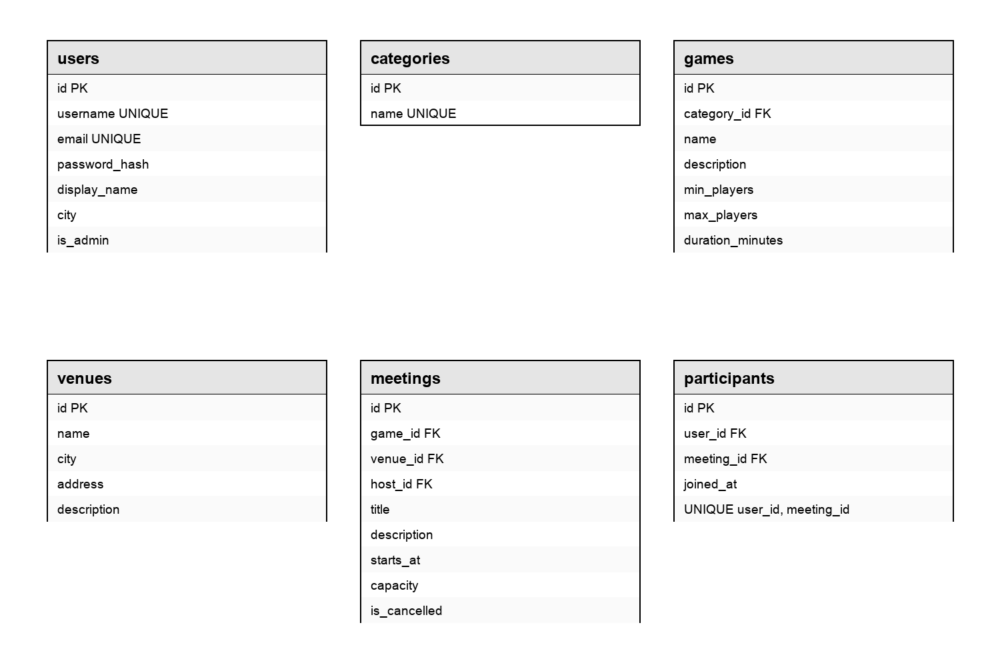

# BoardMate — компанія для настільних ігор

BoardMate допоможе знайти людей для настільних ігор: обрати гру, знайти зустріч у своєму місті або створити власну та запросити інших учасників.

Зараз реалізований **каталог**: CRUD категорій, ігор і місць проведення. Дані зберігаються у SQLite через Django ORM. API написано на Django REST Framework з `APIView` та серіалізаторами, без ViewSets.

Реєстрація, JWT-вхід, оновлення токена та власні дані реалізовані в окремому app `accounts`. Каталог відкритий для читання, а створення, редагування й видалення доступні лише адміністратору (`is_staff=True`). Зустрічі та запис учасників залишаються наступними етапами. Це локальний навчальний сервер.

## Як запустити проєкт

Потрібен Python **3.14**.

```sh
python3.14 -m venv .venv
source .venv/bin/activate
python -m pip install -r requirements.txt
python manage.py migrate
python manage.py createsuperuser
python manage.py runserver 8000
```

Бекенд: `http://127.0.0.1:8000/`. API: `http://127.0.0.1:8000/api/`.

База спочатку порожня. Дані можна створити через Postman або JSON-запитами, описаними нижче. `db.sqlite3` та віртуальне середовище не входять до репозиторію; файли міграцій знаходяться в `catalog/migrations/`.

[Фронтенд — окремий репозиторій](https://github.com/SigmaSigmaSigmaSigmaSigmaSigmaSigmaSigm/boardmate-frontend). Він показує каталог ігор і запускається на `http://127.0.0.1:5500/` командою `python3 -m http.server 5500 --bind 127.0.0.1` у своїй папці.

Для CORS дозволені тільки `http://127.0.0.1:5500` та `http://localhost:5500`. Залежність `django-cors-headers` додає відповідні заголовки; різні порти фронтенду й API демонструють запит між різними джерелами.

## Реєстрація, JWT та права доступу

Користувачі зберігаються у стандартній моделі Django `User`; нова таблиця не потрібна. `create_user()` хешує пароль. Паролі та їх підтвердження не повертаються у відповідях. Реєстрація не може надати права адміністратора; його створюють командою `createsuperuser` вище.

| Метод | Ендпоінт | Доступ | Тіло запиту | Відповідь |
| --- | --- | --- | --- | --- |
| POST | `/api/auth/register/` | Усі, без Authorization | Поля реєстрації нижче | `201`, власні дані без пароля; `400`, помилки полів |
| POST | `/api/auth/login/` | Усі, без Authorization | `username`, `password` | `200`, `access` і `refresh`; `400` — відсутні поля; `401` — неправильні дані |
| POST | `/api/auth/refresh/` | За refresh-токеном, без Authorization | `refresh` | `200`, новий `access`; `400` — немає поля; `401` — недійсний або прострочений refresh |
| GET | `/api/me/` | Авторизований користувач | Без тіла, `Authorization: Bearer <access>` | `200`, власні дані; `401` — немає чинного access |

Тіла запитів — JSON з `Content-Type: application/json`.

### Реєстрація

```json
{
  "username": "marta",
  "first_name": "Марта",
  "last_name": "",
  "email": "marta@example.com",
  "password": "Forest-Game-482!",
  "password_confirmation": "Forest-Game-482!"
}
```

| Поле | Обов’язкове | Обмеження |
| --- | --- | --- |
| `username` | Так | До 150 символів, унікальний; стандартний валідатор ніку Django |
| `first_name` | Ні | До 150 символів, можна пропустити або залишити порожнім |
| `last_name` | Ні | До 150 символів, можна пропустити або залишити порожнім |
| `email` | Так | До 254 символів, коректна адреса; унікальність пошти не вимагається |
| `password` | Так | Від 8 до 128 символів; не лише цифри, не поширений і не надто схожий на дані користувача |
| `password_confirmation` | Так | До 128 символів, має збігатися з паролем |

Після реєстрації треба окремо увійти. Приклад відповіді `201` і відповіді `GET /api/me/`:

```json
{
  "id": 1,
  "username": "marta",
  "first_name": "Марта",
  "last_name": "",
  "email": "marta@example.com",
  "is_staff": false
}
```

Невалідна реєстрація повертає `400` з текстовим підсумком `detail` і повідомленнями для конкретних полів в `errors`:

```json
{
  "detail": "email: Введіть коректну адресу електронної пошти.; password: Пароль занадто короткий.",
  "errors": {
    "email": ["Введіть коректну адресу електронної пошти."],
    "password": ["Пароль занадто короткий."]
  }
}
```

Точний текст залежить від помилки. `errors.non_field_errors` містить помилки всього запиту, наприклад зайві поля.

### Вхід та refresh

Запит входу:

```json
{"username": "marta", "password": "Forest-Game-482!"}
```

Відповідь `200`:

```json
{"access": "<access JWT>", "refresh": "<refresh JWT>"}
```

Access діє **5 хвилин**, refresh — **1 добу**. Для закритих запитів передавайте `Authorization: Bearer <access>`. Приклад: `GET /api/me/` з цим заголовком. Refresh не передається як Bearer-токен.

Коли захищений запит повертає `401`, фронтенд викликає `POST /api/auth/refresh/`:

```json
{"refresh": "<refresh JWT>"}
```

Відповідь `200`:

```json
{"access": "<new access JWT>"}
```

Фронтенд зберігає новий access і повторює початковий запит один раз. Refresh залишається тим самим; його строк не продовжується. Якщо refresh теж прострочений, потрібно увійти знову. Криптографію JWT виконує `djangorestframework-simplejwt`, власного підписування токенів немає.

### Logout і ролі

Logout реалізований на клієнті: кнопка «Вийти» видаляє обидва токени із `sessionStorage` і відкриває каталог. HTTP-ендпоінту logout немає. Уже виданий токен не відкликається на сервері й може діяти до закінчення свого строку.

| Дія | Гість | Звичайний користувач | Адміністратор |
| --- | --- | --- | --- |
| Читання каталогу | Так | Так | Так |
| `GET /api/me/` | `401` | Власні дані | Власні дані |
| POST, PATCH, DELETE каталогу | `401` | `403` | Так, із перевірками даних |

Для `401` повертається `{"detail": "Увійдіть в акаунт: дані входу або токен недійсні."}`, для браку ролі — `403` та `{"detail": "Змінювати каталог може лише адміністратор."}`. Неправильний Bearer-токен також дає `401`.

Для навчального запуску секрет підпису генерується під час старту процесу; після перезапуску сервера потрібно увійти знову. Для сталого секрету встановіть змінну середовища `DJANGO_SECRET_KEY` до запуску сервера, тримайте її поза Git. Застосунок читає змінну з оточення, `.env` автоматично не завантажує.

## REST API

Усі шляхи нижче починаються з `/api/`. Тіла запитів і відповідей — JSON (`Content-Type: application/json`). Для `GET` і `DELETE` тіло не потрібне. `id` створює сервер; передавати його при створенні або редагуванні не можна.

У таблицях `Category`, `Game` і `Venue` — об’єкти з прикладів наступного розділу. `POST` повертає створений об’єкт, `PATCH` — повний оновлений об’єкт. Редагування часткове, передається хоча б одне поле. Видалення повертає `204` без тіла.

### Категорії

| Метод | Шлях | Для чого | Тіло / параметри | Успішна відповідь |
| --- | --- | --- | --- | --- |
| GET | `/categories/` | Список категорій | `page` | `200`, список `Category` |
| GET | `/categories/{id}/` | Окрема категорія | `id` | `200`, `Category` |
| POST | `/categories/` | Створення | `name` | `201`, `Category` |
| PATCH | `/categories/{id}/` | Перейменування | `id`, `name` | `200`, `Category` |
| DELETE | `/categories/{id}/` | Видалення | `id` | `204`, без тіла |

Тіло створення: `{"name": "Стратегії"}`.

Об’єкт `Category`:

```json
{"id": 1, "name": "Стратегії"}
```

Назва до 80 символів, обов’язкова та унікальна після прибирання пробілів на краях. Регістр при перевірці унікальності враховується. Порожня назва — `400`, повторна — `409`.

### Ігри

| Метод | Шлях | Для чого | Тіло / параметри | Успішна відповідь |
| --- | --- | --- | --- | --- |
| GET | `/games/` | Каталог | `search`, `category_id`, `players`, `ordering`, `page` | `200`, список `Game` |
| GET | `/games/{id}/` | Окрема гра | `id` | `200`, `Game` |
| POST | `/games/` | Створення | Усі поля прикладу нижче | `201`, `Game` |
| PATCH | `/games/{id}/` | Редагування | `id`, будь-які поля прикладу | `200`, `Game` |
| DELETE | `/games/{id}/` | Видалення | `id` | `204`, без тіла |

Тіло створення, всі поля обов’язкові:

```json
{
  "name": "Лісові стежки",
  "description": "Гравці прокладають маршрути через ліс.",
  "category_id": 1,
  "min_players": 2,
  "max_players": 4,
  "duration_minutes": 45
}
```

Об’єкт `Game` має ті самі поля плюс `id`. `category_id` — ідентифікатор наявної категорії. Приклад редагування: `{"duration_minutes": 60}`.

- `name` — непорожній рядок до 120 символів, `description` — до 2000.
- Кількість гравців і тривалість — додатні цілі числа.
- `min_players ≤ max_players`. Перевірка враховує попередні значення при частковому редагуванні.
- `search` шукає частину назви; `category_id` фільтрує за категорією.
- `players` — додатне число: повертаються ігри, де `min_players ≤ players ≤ max_players`.
- `ordering`: `name` (типово), `duration_minutes` або `-duration_minutes`.

Приклад: `GET /api/games/?category_id=1&players=3&ordering=-duration_minutes`.

### Місця проведення

| Метод | Шлях | Для чого | Тіло / параметри | Успішна відповідь |
| --- | --- | --- | --- | --- |
| GET | `/venues/` | Список місць | `search`, `city`, `page` | `200`, список `Venue` |
| GET | `/venues/{id}/` | Окреме місце | `id` | `200`, `Venue` |
| POST | `/venues/` | Створення | Усі поля прикладу нижче | `201`, `Venue` |
| PATCH | `/venues/{id}/` | Редагування | `id`, будь-які поля прикладу | `200`, `Venue` |
| DELETE | `/venues/{id}/` | Видалення | `id` | `204`, без тіла |

Тіло створення, всі поля обов’язкові:

```json
{
  "name": "Клуб Гральня",
  "city": "Київ",
  "address": "вул. Прикладна, 10",
  "description": "Місце для зустрічей любителів настільних ігор."
}
```

Об’єкт `Venue` має ті самі поля плюс `id`. Приклад редагування: `{"city": "Львів"}`.

Усі рядки непорожні. Максимальна довжина: назва — 120, місто — 80, адреса — 200, опис — 2000 символів. `search` шукає частину назви, `city` — повну назву міста. Порядок — за назвою.

### Списки

Скрізь підтримується `page`: ціле число від 1, типово 1. На сторінці до 20 записів. Для однакових значень сортування додатково використовується `id` за зростанням. Категорії сортуються за назвою.

Приклад списку категорій; для ігор і місць змінюються лише об’єкти всередині `results`:

```json
{
  "count": 1,
  "page": 1,
  "results": [{"id": 1, "name": "Стратегії"}]
}
```

`count` — загальна кількість результатів після фільтрації. Всі фільтри застосовуються разом. Порожня або завелика сторінка повертає `200` з порожнім `results` та загальною кількістю `count`. Пошук використовує Django `icontains`, місто — `iexact`; у SQLite нечутливість до регістру гарантована лише для латиниці ASCII.

### Бізнес-правила та помилки

Усі помилки API мають текстовий `detail`. Для помилок валідації `400` додатково повертається `errors` з повідомленнями полів:

```json
{
  "detail": "Неможливо видалити категорію: до неї належать 3 ігор. Спочатку видаліть ці ігри або змініть їхню категорію."
}
```

| Статус | Значення та приклад |
| --- | --- |
| `401 Unauthorized` | Немає чинного access-токена для закритої операції. |
| `403 Forbidden` | Користувач увійшов, але не має прав адміністратора. |
| `400 Bad Request` | Некоректний JSON або значення поля: порожній рядок, неправильні межі гравців, відсутня категорія в тілі, порожній PATCH, зайве поле, неправильна сторінка чи сортування. |
| `404 Not Found` | Ресурс за вказаним ID або ендпоінт не існує. |
| `405 Method Not Allowed` | Метод не підтримується, наприклад PUT. |
| `409 Conflict` | Категорія має ігри або її назва вже зайнята. Потрібно змінити поточні дані перед повторенням запиту. |
| `415 Unsupported Media Type` | Тіло передане не як JSON. |

Категорію з іграми захищає зв’язок `ForeignKey(..., on_delete=PROTECT)`: видалення не знищить ігри. `409` обрано тому, що запит коректний, але суперечить поточним зв’язкам. Повідомлення містить кількість ігор і спосіб виправлення. Межі гравців та додатну тривалість додатково перевіряє обмеження бази даних.

Ігри й місця поки можна видаляти: зустрічі ще не реалізовані. Захист їхніх зв’язків зі зустрічами буде додано разом із цим функціоналом.

## Схема бази даних



На схемі з попередньої роботи показаний план застосунку. Зараз міграції створюють `Category`, `Game` та `Venue`; користувачі, зустрічі й участь належать наступним етапам.

## Postman

Імпортуйте [BoardMate.postman_collection.json](postman/BoardMate.postman_collection.json) як Collection v2.1.

`base_url` — змінна колекції, типове значення `http://127.0.0.1:8000/api`. Спочатку створіть адміністратора через `createsuperuser` і заповніть `admin_username` та `admin_password` у змінних колекції. Пароль у файлі колекції не збережений. Запити входу самі зберігають `access` і `refresh`; каталог успадковує Bearer-авторизацію колекції. Запустіть бекенд і виконайте всю колекцію по порядку через Collection Runner. Колекція містить 37 запитів: реєстрацію, вхід, refresh, власні дані, помилки `400`, `401`, `403` і попередній CRUD. Вона створює тестового звичайного користувача, потім входить як адміністратор і створює власну категорію, гру та місце, зберігає ID у змінні, перевіряє всі 15 реалізованих операцій і приклади помилок `400`, `404`, `409`, після чого видаляє створені записи. Чужі дані не змінюються. Тестовий користувач залишається у локальній базі; видалення акаунта не входить до завдання. Приклад гри «Лісові стежки» вигаданий.

У запитів є збережені приклади відповідей та автоматичні перевірки статусів. Якщо перервати запуск, створені до цього записи залишаться у базі.

Запуск без Postman, за наявності Node.js:

```sh
npx --yes newman run postman/BoardMate.postman_collection.json --env-var admin_username=YOUR_ADMIN --env-var admin_password=YOUR_PASSWORD
```

## Перевірки

```sh
python manage.py check
python manage.py makemigrations --check --dry-run
python manage.py test
python -m pip install ruff==0.17.3
ruff check .
ruff format --check .
```

Тести перевіряють реєстрацію, хешування пароля, обмеження полів, складність і підтвердження пароля, JWT, прострочення токенів, ролі, CRUD, помилки, фільтри, пагінацію та CORS із заголовком Authorization. Наявний `uv.lock` дозволяє також встановити середовище командою `uv sync` і запускати перевірки через `uv run`.

## Використання ШІ

Використано Codex для написання CRUD, реєстрації, JWT, прав доступу, серіалізаторів, тестів, Postman-колекції та фронтенду. Результат перевірено тестами, форматером і статичним аналізом; результати запуску Postman та перевірки в браузері вказані в PR. Автоматичні перевірки не замінюють розуміння коду перед захистом.
